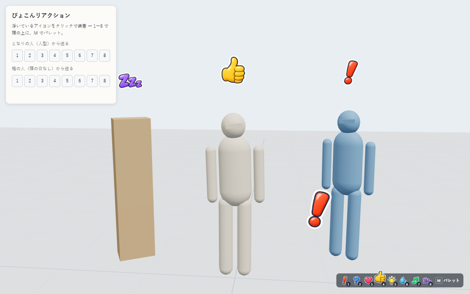
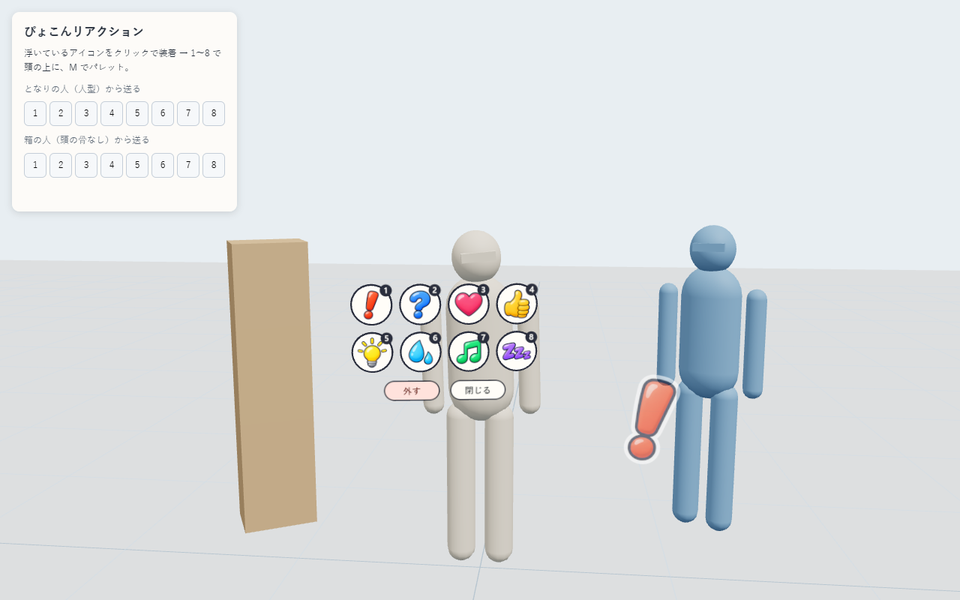
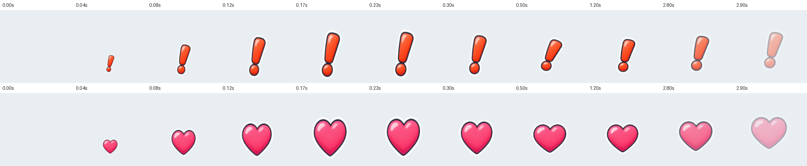

# ぴょこんリアクション

XRiftで、頭の上に絵文字風のアイコンを「ぴょこん」と出すアイテムです。押すと約3秒、自分の頭上で弾んで消えます。同じ部屋の全員に見えます。

[頭上看板（作業中・離席中タグ）](https://github.com/toM7x7/toMoXRift_item_headkanban)の仕組みを土台にしています。土台にしたのは「置いた物を選んで装着」「装着中だけキーが効く」「頭頂を採寸して追従」の3つです。



## 使い方

1. ワールドに置くと、アイコンが入れ替わりながら浮かびます。これを選ぶと装着されます。
2. PCは数字キー、VRは右スティック押し込み（R3）で開くパレットから選びます。
3. 装着中に浮いているアイコンをもう一度選ぶと、パレットが開きます。「外す」で解除します。

| キー | アイコン | | キー | アイコン |
|---|---|---|---|---|
| 1 | ！ びっくり | | 5 | 💡 ひらめき |
| 2 | ？ はてな | | 6 | 💦 あせ |
| 3 | ♥ すき | | 7 | ♪ ごきげん |
| 4 | 👍 いいね | | 8 | 💤 ねむい |
| M | パレットを開く／閉じる | | | |

- キーは、自分が装着している1個だけに効きます。入力欄・IME変換中・キーリピートでは反応しません。
- ホストが通常キーを先に取る環境では、**Ctrl＋Alt＋同じキー**も使えます。公式DevEnvironmentでは、この代替キーが必要です。
- 装着は各自の手元の状態です。1個置けば部屋の誰でも付けられます。
- PCでは画面右下にキーの一覧が出て、押したアイコンがそこでも跳ねます。一人称では自分の頭上が見えないためです。



ぴょこんの動きです。0.2秒で大きく弾んで落ち着き、約2.8秒で消えます。アイコンごとに、揺れる・脈打つ・首をかしげる・漂うなどの癖を付けています。



## 仕組み

| 部分 | 内容 |
|---|---|
| 同期 | 公式の `useInstanceEvent`。イベント名は配置ごと（`head-pop:v1:<配置ID>`）。送り主の userId はサーバーが付けるため、他人の頭にアイコンを出すことはできません。後から入室した人には、過去のリアクションは再生されません |
| 頭の位置 | 頭上看板と同じ avatar-anchor で、描画中の頭の骨と頭メッシュの頂点から頭頂を測り、その42cm上に置きます（名前表示を避けるため）。頭が見つからないとき・曖昧なときは、足元の位置＋アバターの身長で代用します |
| 追従 | `scene.onBeforeRender` で、ホストのアニメーション後に位置を合わせます。カメラ方向へ、傾かない縦向きのまま正対します。鏡などの入れ子の描画でも、その視点へ向き直ります |
| 描画 | 16枠を使い回すため、Reactの再描画は起きません。8種は1枚の画像（`public/head-pop-icons.png`）で、UVで切り分けています |
| 乱打 | 自分は0.11秒、受信は送り主ごとに0.11秒の間隔を空けます |
| 古いホスト | イベントの仕組みがない場合は、自分の画面にだけ出します（`userData.headPop.events` が `unavailable`） |

## 開発

```sh
npm install
npm run verify        # 13テスト＋型＋Itemビルド
npm run dev           # http://127.0.0.1:5262/
node scripts/capture.mjs   # GPU Chromeでの操作確認と撮影（devサーバー起動中）
```

| URL | 内容 |
|---|---|
| http://127.0.0.1:5262/ | 自作骨格の自分、人型のとなりの人、頭の骨がない箱の人。左のパネルから「となりの人」のリアクションを模擬受信できます |
| http://127.0.0.1:5262/?sdk=1 | 公式DevEnvironment。中央レイとCtrl+Altキーで確認します |
| http://127.0.0.1:5262/?shot=1 | サムネイル撮影用（パネル・案内なし） |

アイコン画像は `concepts/sheet-b.png`（Codex生成、Git対象外）から `npm run atlas` で作り直せます。マゼンタ背景と白ふちの混ざり具合から、ふちの透明度を正確に求めています。

Claude内蔵のブラウザーペインは、非表示のあいだ描画が止まります。確認は `scripts/capture.mjs`（GPU Chrome）で行います。

## 確認済みの範囲

- 13のユニットテスト、型、Itemビルド、公式の配布前検査（`xrift check item`、26 JSファイルすべてAPPROVE）
- 自作dev画面＋GPU Chrome
  - 実クリックで装着
  - キー1〜8、Ctrl+Alt、9とShiftを無視、M開閉
  - パレットのボタンでぴょこんして閉じる、外す、外した後はキーが効かない
  - 3人同時表示（人型2人は頭頂、箱型は代用位置）
  - 送信は押した回数だけ
- 公式DevEnvironment 0.60.0：装着前はキーが効かない、Ctrl+Alt+3で表示、Ctrl+Alt+Mでパレットが開く。通常の4はホストに取られて届かない

**未確認**

- 本番XRiftでの他者への表示（`useInstanceEvent` の実配信）
- 本番で数字キーが届くか
- Quest実機のR3とレイ選択
- PCの三人称視点でパレットまでレイが届くか
- 頭上看板と同時に装着したときのキーとR3の重なり（先に登録した方が処理し、もう一方は無視します）

## ライセンス

本体のコードとドキュメントはMIT（[LICENSE](LICENSE)）です。`vendor/` などの出典と条件は [THIRD_PARTY_NOTICES.md](THIRD_PARTY_NOTICES.md) と [sources.lock.json](sources.lock.json) を参照してください。
