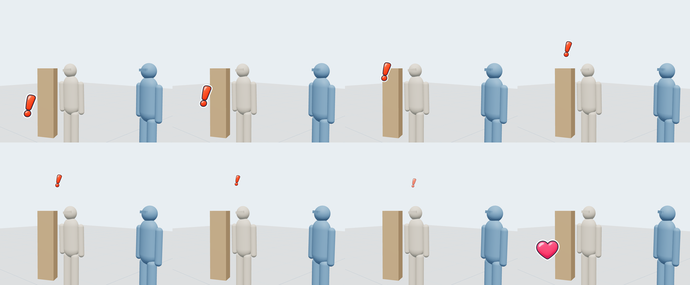
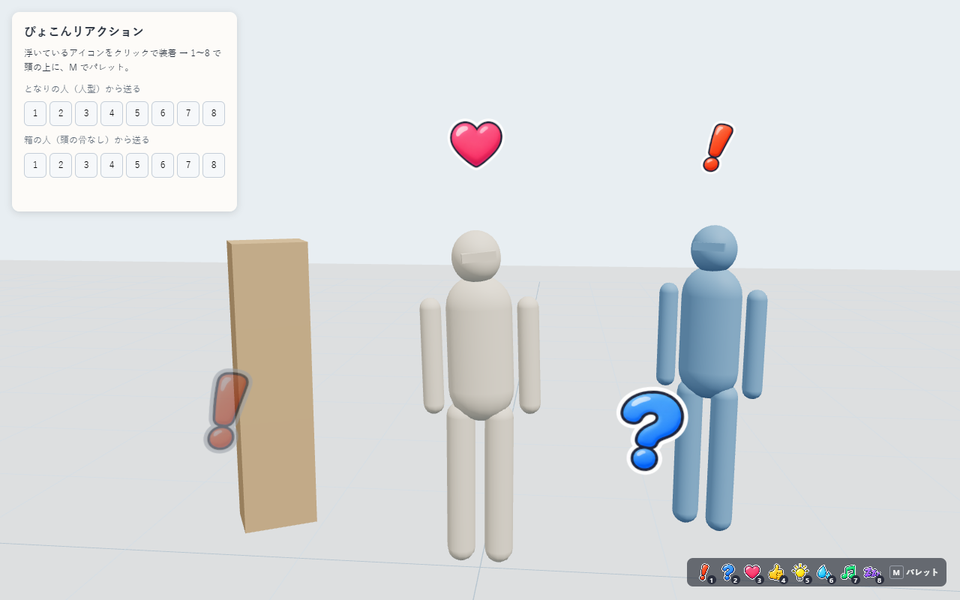
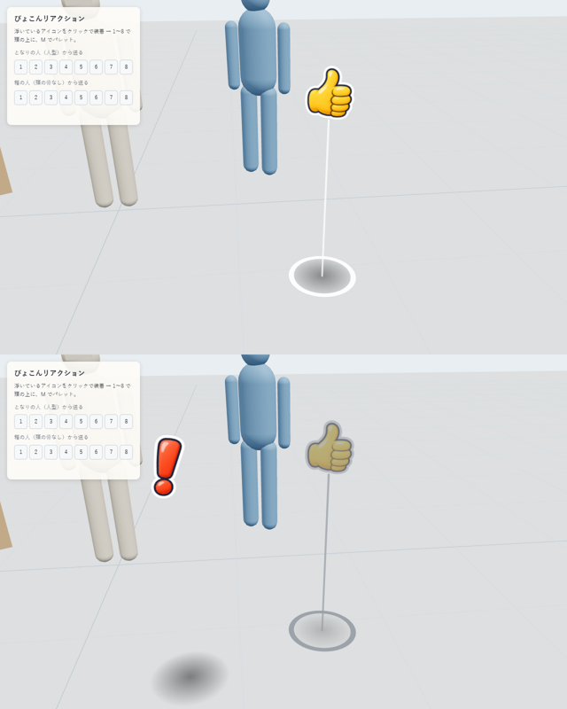
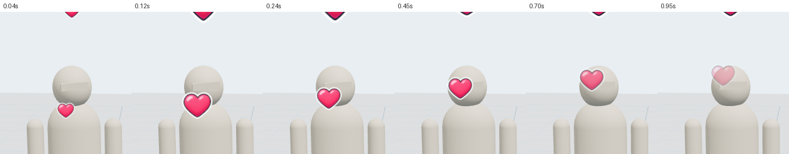
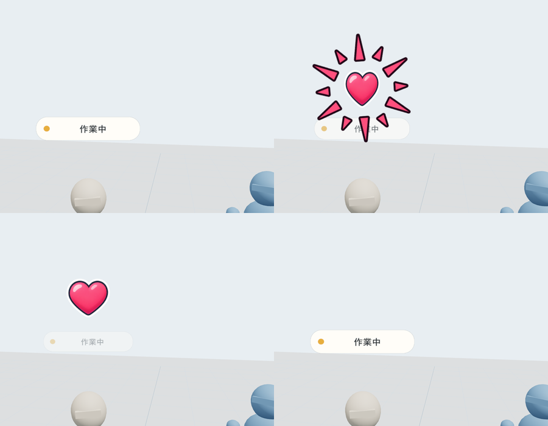
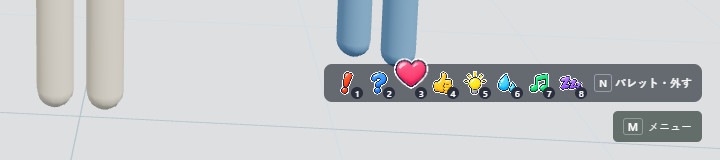

# ぴょこんリアクション

XRiftで、頭の上に絵文字風のアイコンを「ぴょこん」と出すアイテムです。押すと約3秒、自分の頭上で弾んで消えます。同じ部屋の全員に見えます。

[頭上看板（作業中・離席中タグ）](https://github.com/toM7x7/toMoXRift_item_headkanban)の仕組みを土台にしています。土台にしたのは「置いた物を選んで装着」「装着中だけキーが効く」「頭頂を採寸して追従」の3つです。


## 使い方

1. ワールドに置くと、アイコンが入れ替わりながら浮かびます。これを選ぶと装着されます。1人が置けるのは1個で、置いた1個は部屋の誰でも付けられます（アイテムを持っていない人も）。
2. 付けると、アイコンは置き場所から自分の頭の上へぴょこんと移り、置き場所には何も残りません。これは自分の画面だけの変化です。ほかの人には置いたまま見え、誰でも付けられます。
3. PCは数字キー、VRは右スティック押し込み（R3）で開くパレットから選びます。
4. パレット（PCはM）の「外す」で解除すると、アイコンは頭の上から元の場所へ戻ります。



| キー | アイコン | | キー | アイコン |
|---|---|---|---|---|
| 1 | ！ びっくり | | 5 | 💡 ひらめき |
| 2 | ？ はてな | | 6 | 💦 あせ |
| 3 | ♥ すき | | 7 | ♪ ごきげん |
| 4 | 👍 いいね | | 8 | 💤 ねむい |
| M | パレットを開く／閉じる（頭上看板も付けているときは N） | | | |

- キーは、自分が装着している1個だけに効きます。入力欄・IME変換中・キーリピートでは反応しません。
- スマホ・タブレット（マウスが無い端末）と、VRのハンドトラッキングだけのときは、パレットを開くキーやボタンがありません。そのため付けたあともアイコンは置き場所に残り、選ぶとパレットが開きます。
- ホストが通常キーを先に取る環境では、**Ctrl＋Alt＋同じキー**も使えます。公式DevEnvironmentでは、この代替キーが必要です。
- 装着は各自の手元の状態です。1個置けば部屋の誰でも付けられます。

### 置くとき・置きすぎたとき

- 置く前のプレビューでは、アイコンが止まり、床に白い輪と縦線が出ます。床の輪が置き場所です。自分がもう1個置いていると、輪もアイコンも灰色になります。
- 置いたあとは床に影が出ます。アイコンは切り替わるときも小さくなるだけで消えません。PCの中央の照準で狙いやすくするためです。
- 同じ人が2個以上置くと、配置IDがいちばん小さい1個だけが動きます。ほかは灰色で止まり、選ぶと「もう1個置いてあります」と出ます。その灰色の方を片付けてください。
- 別の人が置いた分は、それぞれ動いて誰でも付けられます。何個あってもリアクションは1回ずつしか出ません（表示を担当するのは部屋で1個だけ）。
- 同時に付けられるのは1個です。付けているあいだは、ほかの人が置いた分も自分の画面ではその場で畳まれて消え、外すと戻ります。自分の灰色の2個目は、片付けられるように残します。




- PCでは画面右下にキーの一覧が出て、押したアイコンがそこでも跳ねます。一人称では自分の頭上が見えないためです。

### VRでは

- **付ける**：浮いているアイコンをコントローラーのレイで選び、トリガーを引きます。アイコンが頭の上へ移り、トリガーを引いた手が軽く1回震えます。外したときも1回震えます。
- **パレットを開く／閉じる**：右スティック押し込み（R3）。スティックを倒さず、トリガーとグリップを離して押し込んだときだけ反応します。開くと右手が軽く1回震えます。
- **パレットの位置**：目の少し下、体の前0.7m（手が届く距離）に出ます。開いたときの向きのまま、体の移動にはついてきます。
- **押したとき**：頭上に出るのに合わせて、次の2つで知らせます。どちらも自分にしか見えず、感じられません。
  - 押したボタンの位置から、同じアイコンが小さく浮き上がって消えます。
  - 直前にトリガーを引いた方のコントローラーが、トン・トンと2回震えます。
- **出さないもの**：PC用の右下のキー一覧は、VRでは出しません。
- **ハンドトラッキング**：R3はコントローラーのボタンです。手だけのあいだは、付けたあともアイコンが置き場所に残り、選ぶとパレットが開きます。コントローラーに持ち替えると、また頭の上へ移ります。




ぴょこんの動きです。0.2秒で大きく弾んで落ち着き、約2.8秒で消えます。アイコンごとに、揺れる・脈打つ・首をかしげる・漂うなどの癖を付けています。


出る瞬間の0.4秒だけ、アイコンの色の集中線がアイコンの後ろに広がって消えます。

### 頭上看板と一緒に付けるとき

[頭上看板](https://github.com/toM7x7/toMoXRift_item_headkanban)（v8）も頭のすぐ上に札を出すので、そのままだとリアクションの下半分が札と重なります。リアクション側で次のように合わせます。看板には何も手を入れていません。

- **札の上に出す**：同じ人が看板を付けていて札が出ているときは、リアクションを札の真上（札の上端から5cm空けた位置）に出します。看板を付けていなければ、これまでどおり頭の上です。
- **札を一歩下げる**：リアクションが出ている約3秒だけ、その人の札を薄く（不透明度35%）、少し小さく（86%）します。出始めの0.15秒で下がり、消える前の0.35秒で戻ります。
- **見る人の側へ12cm寄せて描く**：札や名前表示と同じ奥行きで重なっても、隠れたりちらついたりしません。奥行きは本物なので、壁越しには見えません。

札の変化は各自の画面で描くあいだだけです。描き終わるたびに元の値へ戻すので、同期は要りません。どちらかのアイテムが消えても、札が変わったまま残ることはありません。



キーは次のように分けます。看板も1〜4とM、VRの右スティック押し込みを使うためです。

| 操作 | リアクションだけ | 頭上看板も付けているとき |
|---|---|---|
| 1〜8 | リアクション | リアクション（看板の1〜4は効かなくなります。看板の切り替えはMのメニューから） |
| M | パレット | 看板のメニュー |
| N | なし | パレット（「外す」もここ） |
| VRの右スティック押し込み | パレット | 看板のメニュー |
| VRの左スティック押し込み | なし | パレット |

- リアクションのキーは、ほかの受け取り手より先に受け取ります（capture）。処理したキーには「処理済み」の印が付き、看板は印の付いたキーを無視します。
- 看板の右下のキー一覧からは数字の項目を隠し、「M メニュー」だけにします。こちらの一覧はその上に上げます。
- 看板を外すと、パレットはMと右スティックに戻ります。
- 看板を付けているかどうかは、看板自身のキー登録（`Symbol.for('xrift.presence.shortcuts.v1')`）で見ます。



## 仕組み

| 部分 | 内容 |
|---|---|
| 同期 | 公式の `useInstanceEvent`。イベント名は部屋で1つ（`head-pop:v2`）。送り主の userId はサーバーが付けるため、他人の頭にアイコンを出すことはできません。後から入室した人には、過去のリアクションは再生されません |
| 1人1個 | XRiftには、アイテムの配置数を制限する設定が公開されていません。公式のドキュメント・テンプレート・公式アイテム・world-components のどれにも `singlePlace` は無く、読み込み処理も `Item` しか見ていません。そこで各コピーが互いを見つけ（`src/placements.mjs`）、置いた人（`useItem().placedBy.id`、サーバーが確定）ごとに配置IDが最小の1個だけを動かします。受信と頭上の表示は、動いているコピーのうち配置IDが最小の1個だけが担当します。プレビュー中のコピーは数えません。ワールドに組み込まれた配置（置いた人が `null`）は1つのまとまりとして扱います |
| 頭の位置 | 頭上看板と同じ avatar-anchor で、描画中の頭の骨と頭メッシュの頂点から頭頂を測り、その42cm上に置きます（名前表示を避けるため）。頭が見つからないとき・曖昧なときは、足元の位置＋アバターの身長で代用します |
| 付けたあと | 自分が付けているかどうかは各自の手元の状態です（`src/wearing.mjs`）。付けたら、その1個は頭の上（リアクションが出る位置）へ0.55秒で弧を描いて移り（`src/flight.mjs`）、ほかの動いているコピーはその場で畳まれます。どちらも選べる当たり判定ごと消えます。PCは「マウスやタッチパッドがある端末」、VRは「R3を読める右コントローラーがある」ときだけ消し、それ以外はパレットへの入口として残します |
| 追従 | `scene.onBeforeRender` で、ホストのアニメーション後に位置を合わせます。カメラ方向へ、傾かない縦向きのまま正対し、カメラ側へ12cm寄せます。鏡などの入れ子の描画でも、その視点へ向き直ります |
| 頭上看板 | `src/sign.mjs`。共通のキーは使わず、シーンの中から `userData.presence.ownerId`（看板を付けている人）を持つ物と、その中の `…:presence:tag-menu` の札を0.4秒ごとに探します。札が見えているときだけ、その上に積み、札の不透明度と大きさを描画中だけ下げて、外側の描画が終わったら戻します。キーの分け方も同じファイル（`headTagWornHere`・`paletteControls`） |
| 描画 | 16枠を使い回すため、Reactの再描画は起きません。8種は1枚の画像（`public/head-pop-icons.png`）で、UVで切り分けています |
| 乱打 | 自分は0.11秒、受信は送り主ごとに0.11秒の間隔を空けます |
| 古いホスト | イベントの仕組みがない場合は、自分の画面にだけ出します（`userData.headPop.events` が `unavailable`） |

## 開発

```sh
npm install
npm run verify        # 30テスト＋型＋Itemビルド
npm run dev           # http://127.0.0.1:5262/
node scripts/capture.mjs   # GPU Chromeでの操作確認と撮影（devサーバー起動中）
```

| URL | 内容 |
|---|---|
| http://127.0.0.1:5262/ | 自作骨格の自分、人型のとなりの人、頭の骨がない箱の人。左のパネルから「となりの人」のリアクションを模擬受信できます |
| http://127.0.0.1:5262/?sdk=1 | 公式DevEnvironment。中央レイとCtrl+Altキーで確認します |
| http://127.0.0.1:5262/?dup=1 | 自分の2個目（灰色で止まるか） |
| http://127.0.0.1:5262/?dup=1&other=1 | さらに、となりの人が置いた1個（動くか、リアクションが1回ずつか） |
| http://127.0.0.1:5262/?preview=solo | 置く前のプレビュー（まだ置いていない） |
| http://127.0.0.1:5262/?preview=1 | 置く前のプレビュー（自分がもう置いている） |
| http://127.0.0.1:5262/?shot=1 | サムネイル撮影用（パネル・案内なし） |
| http://127.0.0.1:5262/?sign=1 | 本物の頭上看板を並べて置く。`../../references/headkanban-ref` に頭上看板を clone してあるときだけ読み込みます |

アイコン画像は `concepts/sheet-b.png`（Codex生成、Git対象外）から `npm run atlas` で作り直せます。マゼンタ背景と白ふちの混ざり具合から、ふちの透明度を正確に求めています。

Claude内蔵のブラウザーペインは、非表示のあいだ描画が止まります。確認は `scripts/capture.mjs`（GPU Chrome）で行います。

## 配信

| 版 | 日時 | 内容ハッシュ | 確認 |
|---|---|---|---|
| 1 | 2026-11-04 10:09 JST | `72f06e1a5fe2` | アイテムID `7bf3bc55-efba-4ae0-a8ed-98a12317ceee`。CDNの28ファイルすべてが手元の dist と一致（SHA-256）。審査の結果（ACTIVE）は未確認 |
| 2 | 2026-11-04 10:25 JST | `14e4ebdbff00` | 1部屋に1個、置く前のプレビュー（床の輪と縦線）、床の影、消えないアイコン、部屋で1つのイベント名（`head-pop:v2`）。CDNの28ファイルすべてが一致。審査の結果は未確認 |
| 3 | 2026-11-04 11:24 JST | `cc790f5ae737` | 1部屋1個をやめて1人1個に（`placedBy`）。別の人が置いた分は動き、リアクションの表示は部屋で1個だけが担当。CDNの28ファイルすべてが一致。審査の結果は未確認 |
| 4 | 2026-11-04 11:30 JST | `fb2d99753c64` | VRの手応え（押したボタンから浮く小さな表示、コントローラーの振動、R3で開くときの軽い振動）。CDNの28ファイルすべてが一致。審査の結果は未確認 |
| 5 | 2026-11-04 21:26 JST | `8131fb2d1004` | 付けると置き場所から頭の上へ移り、外すと戻る（自分の画面だけ）。スマホとVRの手だけのときは置き場所に残す。CDNの28ファイルすべてが一致。審査の結果は未確認 |
| 6 | 2026-11-04 21:45 JST | `60535f79dc9f` | 説明文を3文に短くした。中身は版5と同じ（説明だけでは新しい版にならないため、サムネイルに画素の変わらない文字情報を足した）。CDNの28ファイルすべてが一致。審査の結果は未確認 |
| 7 | 2026-11-04 22:03 JST | `59ae27e1555a` | 頭上看板と一緒に付けたとき、リアクションを札の上に出し、表示中は札を下げる。カメラ側へ12cm寄せて描く。出る瞬間の集中線。CDNの28ファイルすべてが一致。審査の結果は未確認 |
| 8 | 2026-11-04 22:15 JST | `e8bbe8dad31c` | 頭上看板と両方付けたときのキーの分け方（数字はリアクション、Mは看板、パレットはN、VRは左スティック押し込み）。看板のキー一覧は「M メニュー」だけにして、こちらの一覧を上に。CDNの28ファイルすべてが一致。審査の結果は未確認 |

既存アイテムの更新には、作者の手元の `.xrift/item.json` が必要です（Git対象外）。初めてcloneした環境でアップロードすると、新しいアイテムIDが作られます。

## 確認済みの範囲

- 30のユニットテスト（振動は偽のXRセッションで、手の選び方・2回のタップ・代わりのAPI・失敗時の扱い。付けたときの移動の進み方と戻り方、装着状態の通知、R3を読めるコントローラーの判定。頭上看板の見つけ方、札の上への積み方、札を下げて描画後に戻すこと、カメラ側へ寄せること、集中線の時間、看板を付けているときのキーと手の分け方）、型、Itemビルド、公式の配布前検査（`xrift check item`）
- 自作dev画面＋GPU Chrome（70項目）
  - 実クリックで装着
  - 付けると置き場所から頭の上へ移って消え、選べる当たり判定も残らない。外すと元の場所に戻り、また付けられる（時計を止めてコマ送りで撮影）
  - となりの人の1個を付けると、自分の1個もその場で畳まれる。自分の灰色の2個目は残る
  - スマホ相当（タッチのみ）と、VRの手だけのときは、付けたあとも置き場所に残る
  - 本物の頭上看板 v8 を同じ頭に付けて、出る瞬間に集中線、リアクションの下端が札の上端より上、表示中は札が下がり、描画と描画のあいだと消えたあとは札が元のまま
  - 同じく両方付けて、2と3はリアクションになり看板は離席中にも外れもしない、Mは看板のメニュー、Nはパレット（閉じるもN）、右下の2つのキー一覧が重ならず看板側は「M メニュー」だけ、VRの右スティックではパレットが開かず左スティックで開く、看板を外すとMでパレット
  - キー1〜8、Ctrl+Alt、9とShiftを無視、M開閉
  - パレットのボタンでぴょこんして閉じる、外す、外した後はキーが効かない
  - 3人同時表示（人型2人は頭頂、箱型は代用位置）
  - 送信は押した回数だけ
  - 自分が2個置くと片方だけが動き、灰色の方は装着できない
  - となりの人が置いた1個は動き、自分も付けられる。そこから押したリアクションも1回だけ表示
  - 置く前のプレビューは選べない。自分がもう置いていると灰色になる
  - 偽のXRセッションを本体の経路に渡して、次を確認：R3でパレットが開いて軽く震える、トリガーを引いたままのR3は無視、ボタンを押すと頭上に出て2回震える、押したボタンから手元の表示が出る、XR中はPCのキー一覧を出さない
- 公式DevEnvironment 0.60.0：中央の照準のクリックで装着、付けると置き場所から頭の上へ移る、装着前はキーが効かない、Ctrl+Alt+3で表示、Ctrl+Alt+Mでパレットが開く。通常の4はホストに取られて届かない

**未確認**

- 本番XRiftでの他者への表示（`useInstanceEvent` の実配信）
- 本番で数字キーが届くか
- 本番の配置プレビューで、`placement.mode` が `preview` になり、床の輪が見えるか
- 本番で `useItem().placedBy` が入るか（入らない場合は部屋で1個として動きます）
- Quest実機のR3・レイ選択・振動（本物のコントローラーでは試していません）
- PCの三人称視点でパレットまでレイが届くか
- 本番で付けたときの移動の見え方（一人称では、頭の上へ抜けて画面の上に消えるはず）
- XRiftのスマホ版で、マウスの無い端末と判定されて置き場所に残るか
- 本番で、ほかの人が付けている頭上看板の上に積まれるか（devでは自分の看板だけ確認）
- 本番で、頭上看板と両方付けたときのキーの分け方（Nと左スティック押し込みがホストに取られていないか）

## ライセンス

本体のコードとドキュメントはMIT（[LICENSE](LICENSE)）です。`vendor/` などの出典と条件は [THIRD_PARTY_NOTICES.md](THIRD_PARTY_NOTICES.md) と [sources.lock.json](sources.lock.json) を参照してください。
